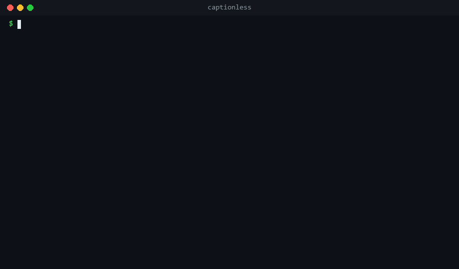

# captionless

[](https://github.com/moatezLita/captionless/actions/workflows/tests.yml)

Transcribe any YouTube video, even one with no captions. Give it a link and get the full text with timestamps and subtitles, saved in a tidy folder.



It is one tool that you can use in four ways:

- **As a Claude Code plugin.** Paste a link in the chat and ask for a summary, notes, a translation or a search.
- **As an MCP server** for apps without a terminal, such as Claude Desktop and Cursor.
- **As a skill in another AI agent** that supports skills.
- **As a plain command** in any terminal, with no AI assistant at all.

Most "YouTube transcript" tools only fetch captions that already exist, so they fail on the many videos that have none. captionless listens to the audio instead, with the speech-to-text service you choose: Groq, OpenAI, Google Gemini, any OpenAI-compatible server, or a Whisper model running on your own computer. You bring your own key. Some of these services have a free tier, and the local model needs no key. With a fast cloud service, an hour-long video takes about two minutes.

In Claude Code it looks like this:

```
> Transcribe this and give me the key points: https://www.youtube.com/watch?v=...

  Transcribed 58 minutes in 1 min 54 s. Saved to YouTube Transcripts/Channel/Title [id]/
  - [02:10] The speaker opens with ...
  - [14:35] ...
```

It works in any language Whisper understands (about 100), and also on playlists, other video sites, and audio or video files on your computer.

## Install

You need Python 3.11 or newer, and either [Deno](https://deno.com) or Node.js 20+ (YouTube downloads require a JavaScript runtime).

### 1. Get the tool

Choose the way you want to use it.

**Claude Code plugin.** Inside [Claude Code](https://claude.com/claude-code):

```
/plugin marketplace add moatezLita/captionless
/plugin install captionless@captionless
```

**Plain command.** With [pipx](https://pipx.pypa.io) or [uv](https://docs.astral.sh/uv/):

```
pipx install git+https://github.com/moatezLita/captionless
captionless "https://www.youtube.com/watch?v=..."

# or, without installing anything:
uvx --from git+https://github.com/moatezLita/captionless captionless "https://www.youtube.com/watch?v=..."
```

Or clone the repository and run the script directly. It sets itself up on the first run:

```
git clone https://github.com/moatezLita/captionless
python3 captionless/skills/transcribe/scripts/captionless.py "https://www.youtube.com/watch?v=..."
```

**Claude Desktop, Cursor and other MCP apps.** See [Use as an MCP server](#use-as-an-mcp-server).

**Another AI agent.** Copy the `skills/transcribe` folder into that agent's skills directory.

### 2. Add a speech-to-text key

Pick a service from the [providers table](#providers) and save its key where the tool can find it. Either set an environment variable:

```
# macOS / Linux (add to ~/.zshrc or ~/.bashrc to keep it)
export OPENAI_API_KEY="your-key"      # or GROQ_API_KEY, or GEMINI_API_KEY

# Windows (then open a new terminal)
setx OPENAI_API_KEY "your-key"
```

or put it in the file `~/.captionless/config.env`:

```
OPENAI_API_KEY=your-key
```

To use no service at all, skip this step and add `--provider local`: the transcription then runs on your own computer.

When you run the script from a clone or through the plugin, the first transcription sets up a private Python environment in `~/.captionless` (about a minute); nothing is installed globally.

## Use in Claude Code

Ask in plain words, or call the skill directly with `/captionless:transcribe <link>`.

| You say | What happens |
|---|---|
| "Transcribe https://youtu.be/..." | Transcript, subtitles and a summary are saved, and you get the short version in chat |
| "Summarize this lecture as study notes: <link>" | Notes written from the transcript, with clickable timestamps |
| "Transcribe this whole playlist: <link>" | Every video is done in turn; ones already finished are skipped |
| "Watch this channel for new videos: <link>" | The channel is remembered, and "check my channels" transcribes whatever is new |
| "Make French subtitles for <link>" | A translated `subtitles.fr.srt`, ready to upload |
| "Give me a clean reading version" | `reading.md`: the same words, with punctuation and paragraphs added |
| "Where did she talk about pricing?" | Searches everything you have transcribed and answers with links to the exact moments |
| "It keeps writing 'Jon' instead of 'John'" | The fix is remembered for that channel and applied to old and new transcripts |

To transcribe on a bare link with no other words, add this line to your `CLAUDE.md`:

```
When my message is only a video link, transcribe it with the captionless skill and give me a short summary.
```

## What you get

```
YouTube Transcripts/
  Channel name/
    corrections.txt            optional: your spelling fixes for this channel
    Video title [video-id]/
      transcript.txt           full text in paragraphs, with [mm:ss] timestamps and chapter headings
      subtitles.srt            subtitles, timed to the audio
      transcript.md            optional: Markdown with clickable timestamps (--formats md)
      subtitles.vtt            optional: WebVTT subtitles (--formats vtt)
      summary.md               written by your AI assistant, plus any notes or translations you ask for
```

The folder is created on your Desktop, or in your home folder if you have no Desktop. Set `CAPTIONLESS_OUT` to put it somewhere else.

## Features

- **No captions needed.** The audio is transcribed with Whisper large-v3 or the model you choose.
- **Captions first, when they are good.** If the uploader wrote captions in the spoken language, those are used instantly and no quota is spent. Automatic captions are ignored by default because AI transcription is usually more accurate.
- **Long videos.** The audio is cut at quiet moments into ten-minute pieces, sent in parallel, and stitched back together with correct timestamps.
- **Chapters.** When a video has chapters, they become headings in the transcript.
- **Playlists and channels** with skip-what's-done, so the same command can be repeated until a long series is finished.
- **Watch for new videos.** Follow channels and playlists, and transcribe only what appeared since the last check.
- **Resumes after a rate limit.** Finished pieces are kept, so a run that hits a free-tier limit continues later instead of starting over.
- **Search across everything you have transcribed,** tolerant of case, accents and Arabic spelling variants, with links that open the video at the right second.
- **Per-channel corrections** for names and terms that speech recognition keeps getting wrong.
- **Markdown and WebVTT copies** for note apps such as Obsidian and Notion, and for web players.
- **English translation** straight from the audio (`--translate`), and subtitles in any other language through your AI assistant.
- **A clean reading version** on request: your AI assistant adds punctuation and paragraphs without changing the words. This helps most in languages that Whisper writes without punctuation, such as Arabic.

## Providers

No service is required or preferred: use whichever you have a key for. If you have set more than one key, choose with `--provider` or the `CAPTIONLESS_PROVIDER` setting; without a choice, the first one in this table that has a key is used.

| Provider | Setting | Default model | Cost | Status |
|---|---|---|---|---|
| Groq | `GROQ_API_KEY` | `whisper-large-v3` | Free tier, about 8 hours of audio a day at the time of writing | Tested |
| OpenAI | `OPENAI_API_KEY` | `whisper-1` | Paid | Written to the API docs, not yet tested |
| Google Gemini | `GEMINI_API_KEY` | `gemini-flash-latest` | Free tier | Written to the API docs, not yet tested |
| Any OpenAI-compatible server | `CAPTIONLESS_BASE_URL`, plus `CAPTIONLESS_API_KEY` and `CAPTIONLESS_MODEL` if needed | `whisper-1` | Yours | Tested against a stand-in server only |
| Local Whisper | none: `--provider local` | `large-v3-turbo` | Free and offline | Tested on CPU |

Notes:

- **Local** runs [faster-whisper](https://github.com/SYSTRAN/faster-whisper) on your machine. It is private and unlimited, but slower, and it downloads the model (about 1.6 GB) on first use. An NVIDIA GPU is used when the CUDA libraries are installed; otherwise it falls back to the CPU. If you installed with pipx, add the package with `pipx inject captionless faster-whisper`.
- **Gemini** estimates timestamps itself, so they are approximate.
- **OpenAI's** newer `gpt-4o-transcribe` models return no timestamps, so each ten-minute piece gets a single one. `whisper-1` gives full timestamps.

If you try one of the untested providers, please [open an issue](https://github.com/moatezLita/captionless/issues) with what happened, working or not.

## Use from the command line

The tool is a single Python script, `skills/transcribe/scripts/captionless.py`. Installed with pipx or uv, it is the `captionless` command. It writes `transcript.txt` and `subtitles.srt`; the summary is the part an AI assistant adds.

```
captionless <links or files> [options]       transcribe
captionless search "words"                   search saved transcripts
captionless fix                              re-apply corrections.txt to saved transcripts
captionless export [folder]                  make transcript.md and subtitles.vtt for saved transcripts
captionless watch add|list|remove|run        follow channels and playlists
captionless mcp                              run as an MCP server
captionless doctor                           check keys, JavaScript runtime and folders
captionless update                           upgrade the downloader
```

Common options: `--lang es`, `--translate`, `--playlist --from 10 --to 20`, `--limit 5`, `--provider local`, `--model <name>`, `--captions any|never`, `--formats md,vtt`, `--force`, `-o <folder>`. Run with `--help` for the full list.

### Watch channels and playlists

```
captionless watch add "https://www.youtube.com/@SomeChannel"
captionless watch run
```

`watch add` remembers the link and leaves the videos that are already there alone. Each `watch run` transcribes what appeared since the last check: for a channel it looks at the newest 50 uploads, for a playlist at the whole list. A video that fails is tried again on the next two runs.

`watch run` only works when it is run. To have it happen every morning, schedule it:

```
# macOS / Linux: add this line with `crontab -e`
0 7 * * * captionless watch run

# Windows
schtasks /Create /SC DAILY /ST 07:00 /TN "captionless watch" /TR "captionless watch run"
```

If you run the script from a clone, replace `captionless` with `python3 /full/path/to/captionless.py`.

## Use as an MCP server

`captionless mcp` runs the same tool as a [Model Context Protocol](https://modelcontextprotocol.io) server, for apps that have no terminal. It offers five tools: `transcribe`, `read_transcript`, `search_transcripts`, `list_transcripts`, and `save_note` (which saves a summary or translation next to the transcript).

In Claude Desktop, open Settings, then Developer, then Edit Config, and add:

```json
{
  "mcpServers": {
    "captionless": {
      "command": "uvx",
      "args": ["--from", "git+https://github.com/moatezLita/captionless", "captionless", "mcp"]
    }
  }
}
```

Or, from a clone, point it at the script:

```json
{
  "mcpServers": {
    "captionless": {
      "command": "python",
      "args": ["C:\\path\\to\\captionless\\skills\\transcribe\\scripts\\captionless.py", "mcp"]
    }
  }
}
```

On macOS and Linux the command is `python3` and the path looks like `/Users/you/captionless/skills/transcribe/scripts/captionless.py`. Restart the app, then paste a video link and ask for what you want.

- **Keys.** Desktop apps often don't see the variables you set in a terminal. The file `~/.captionless/config.env` always works. On Windows, a key saved with `setx` is found too.
- **Long videos.** A transcription that takes more than about 50 seconds answers "still working", and the assistant collects the result with a second call. Nothing is lost in between.
- **One video at a time.** Playlists and watching are command-line features for now.

The server has been tested with the official MCP client library. It has not yet been tried inside Claude Desktop or Cursor themselves; please report how it goes.

## Settings

Set these as environment variables or as lines in `~/.captionless/config.env`.

| Setting | Meaning |
|---|---|
| `GROQ_API_KEY`, `OPENAI_API_KEY`, `GEMINI_API_KEY` | Provider keys |
| `CAPTIONLESS_PROVIDER` | Default provider: `groq`, `openai`, `gemini`, `custom` or `local` |
| `CAPTIONLESS_MODEL` | Default model name |
| `CAPTIONLESS_OUT` | Folder for transcripts |
| `CAPTIONLESS_FORMATS` | Extra files to write every time: `md`, `vtt` or `md,vtt` |
| `CAPTIONLESS_BASE_URL`, `CAPTIONLESS_API_KEY` | An OpenAI-compatible server, for example `http://localhost:8000/v1` |

## Troubleshooting

- **Download errors.** Video sites change often. Run `captionless update` (or ask Claude to "update captionless") and try again.
- **"No JavaScript runtime was found."** Install Deno: `winget install DenoLand.Deno`, `brew install deno`, or `curl -fsSL https://deno.land/install.sh | sh`.
- **"Sign in to confirm you're not a bot", or age-restricted videos.** Add `--cookies-from-browser chrome` (or `edge`, `firefox`, `safari`).
- **Rate limit reached.** The message says how long the wait is. Run the same command again later and it continues where it stopped.
- **The text is nonsense or repeated letters.** Run again with `--force`. If you used `--prompt`, remove it: a hint that doesn't fit can derail Whisper.
- **Local mode ignores the GPU on Windows.** Install the CUDA libraries into the tool's environment: `~/.captionless/venv/Scripts/python -m pip install nvidia-cublas-cu12 "nvidia-cudnn-cu12>=9,<10"`.

## Accuracy, privacy and fair use

Speech recognition is very good on clear speech and still makes mistakes, mostly in names, rare words and quotations. Check anything you plan to publish, especially scripture, legal or medical wording, and exact quotes.

With a cloud provider, the audio of each video is sent to that provider under its own terms; some free tiers may use what you send to improve their products. Your keys stay on your machine and are sent only to the provider they belong to. Use `--provider local` to keep everything on your computer.

captionless is meant for personal use: study, notes, accessibility, and working with videos you have the right to use. Downloading may be against a site's terms of service, and transcripts of other people's videos remain their work. Respect creators and copyright.

## Status

Version 0.2.

- **Used for real on Windows,** with Groq and with the local model: single videos, playlists, watching, search, and the MCP server.
- **Tested automatically on Linux, macOS and Windows** on every change (the badge at the top shows the latest result). Those tests cover installing, the first-run setup, audio cutting and stitching, resuming after a rate limit, the output files, search, corrections, watching and the MCP server. They use a stand-in speech-to-text server and local files, so they do not prove that downloads from video sites work on macOS and Linux; that part relies on [yt-dlp](https://github.com/yt-dlp/yt-dlp), which supports all three.
- **Not yet tested:** OpenAI, Gemini, a real self-hosted server, and the MCP server inside Claude Desktop or Cursor.

Reports and pull requests are welcome. To run the tests: `python -m unittest discover -s tests -v`.

## License

[MIT](LICENSE)
